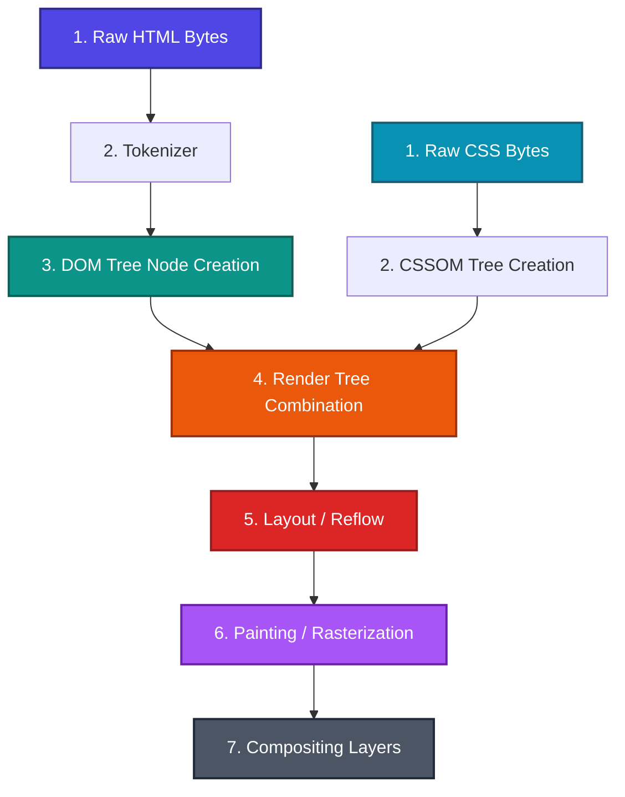

### 1. The Browser Rendering Pipeline & DOM Tree

Understanding HTML requires knowing how the browser translates raw markup bytes into pixels on a screen. This sequence of steps is called the **Critical Rendering Path (CRP)**.
*   **Analogy**: Preparing a pop-up book.



1.  **Raw HTML Bytes**: Raw trees and paper fiber. The raw code bytes are downloaded from the server.
2.  **Tokenizer**: A factory machine cutting cards into shapes (tags). The stream of text characters is parsed into distinct tag tokens (e.g. `StartTag: <html>`).
3.  **DOM Tree Nodes**: The individual cut-out cardboard pieces (DOM Elements). Nodes are instantiated based on the tokens.
4.  **DOM Tree**: Gluing the cut-out cardboard pieces together so they nest correctly into one another. A parent-child node hierarchy is constructed.
5.  **CSSOM Tree**: Parallel instructions specifying how to paint and color each cardboard piece.
6.  **Render Tree**: Selecting only the visible cardboard pieces. If a piece has `display: none` specified in the CSSOM instructions, it is folded completely out of sight.
7.  **Layout (Reflow)**: Drawing blueprint grids to calculate the exact dimensions (width, height, coordinates) of each cardboard piece relative to the viewport.
8.  **Painting (Rasterization)**: Spray-painting colors, text, and images onto each cardboard piece.
9.  **Compositing**: Merging the background, middle ground, and pop-up layers onto the final page screen.

#### Parser-Blocking Scripts: Construction Site Crew
By default, if the crew building the wall encounters a special blueprint document (a `<script>` tag), they drop their bricks, run to download the document, read it immediately, and only then return to laying bricks (blocking the parser).
*   **`defer`**: "Read this blueprint during lunch." The crew continues laying bricks, downloading the script in the background, and only runs it *after* the DOM tree is fully parsed. Order of execution is preserved.
*   **`async`**: "Run this blueprint the second it arrives." The crew continues laying bricks, downloading the script in the background, but drops everything to run it immediately when it finishes, interrupting the parser.

---

### 2. Semantic Markup & Web Accessibility (a11y)

Semantic HTML means using tags that describe the *meaning* of the content, not how it looks.
*   **Analogy**: Labeling rooms in a public building.
    *   *Non-semantic* `<div id="nav">`: A room with a generic cardboard wall that you happen to walk through.
    *   *Semantic* `<nav>`: An architectural archway clearly marked "HALLWAY" in concrete. If a blind visitor walks in (screen reader), they can feel the archway shape and know instantly they are in a navigation area.

```
        Traditional Non-Semantic Layout               Semantic HTML5 Layout
        ┌───────────────────────────────┐               ┌───────────────────────────────┐
        │     <div id="header">         │               │          <header>             │
        ├───────────────────────────────┤               ├───────────────────────────────┤
        │     <div id="nav">            │               │            <nav>              │
        ├───────────────────────────────┤               ├───────────────────────────────┤
        │     <div id="main-content">   │               │            <main>             │
        │   ┌────────────────────────┐  │               │   ┌────────────────────────┐  │
        │   │  <div class="post">    │  │               │   │       <article>        │  │
        │   └────────────────────────┘  │               │   └────────────────────────┘  │
        ├───────────────────────────────┤               ├───────────────────────────────┤
        │     <div id="sidebar">        │               │            <aside>            │
        ├───────────────────────────────┤               ├───────────────────────────────┤
        │     <div id="footer">         │               │            <footer>           │
        └───────────────────────────────┘               └───────────────────────────────┘
```

#### Key Semantic Structural Elements
*   `<header>`: Introduces a page or section (contains logo, search form, or navigation).
*   `<nav>`: Defines a block of navigation links.
*   `<main>`: Represents the primary content of the document. **Only one `<main>` is allowed per page.**
*   `<article>`: Represents self-contained, independent content that could be distributed or reused (e.g., a blog post, forum card, or news article).
*   `<section>`: Groups related content together under a single thematic heading.
*   `<aside>`: Represents content tangentially related to the main content (e.g. sidebars or callouts).
*   `<footer>`: Concludes a page or section (contains copyrights, contact links).

#### Accessible Rich Internet Applications (ARIA)
When standard HTML elements are not enough, ARIA attributes provide metadata to screen readers to make web apps accessible:
*   `role="..."`: Defines the purpose of an element (e.g. `role="dialog"`, `role="button"`, `role="alert"`).
*   `aria-label="..."`: Provides an invisible text description for screen readers when no visible text label exists.
*   `aria-describedby="..."`: Points to the `id` of another element containing a detailed description of this element.
*   `aria-hidden="true"`: Hides decorative elements (like icons) from screen readers.

```html
<!-- Accessible Button with Icon -->
<button aria-label="Close dialog" onclick="closeModal()">
  <span class="icon-close" aria-hidden="true">×</span>
</button>
```

---

### 3. Forms, Input Validation & Properties

#### Form Controls: Club Gate Security Guards
*   `readonly`: A VIP guest who is not allowed to edit their ID card, but the gate security guard still checks their card and lets them in (submitted with the form).
*   `disabled`: A guest who has their ticket confiscated and is turned away; their data is completely ignored by the guard (not submitted with the form).

```html
<!-- Form with Constraint Validation -->
<form action="/register" method="POST">
  <label for="username">Username (5-10 chars):</label>
  <input type="text" id="username" name="username" minlength="5" maxlength="10" required>
  
  <label for="zipcode">Zip Code (5 digits):</label>
  <input type="text" id="zipcode" name="zipcode" pattern="[0-9]{5}" required>
  
  <button type="submit">Submit</button>
</form>
```

---

### 4. Browser Data Storage & Cookies

Websites store data in the user's browser using different storage APIs:
*   **Cookies**: *Analogy: A small luggage tag on your briefcase.* Every time you cross a border (send an HTTP request), the customs agent reads the tag automatically. Small size (~4KB) but automatic.
*   **LocalStorage**: *Analogy: A personal safe box in your hotel room.* It stays there forever unless you manually empty it.
*   **SessionStorage**: *Analogy: A temporary locker.* Cleared the second you check out of the room (close the browser tab).
*   **IndexedDB**: *Analogy: A massive storage warehouse with an indexing system.* Used for large objects, catalogs, and file caching.

| Feature | Cookie | LocalStorage | SessionStorage | IndexedDB |
| --- | --- | --- | --- | --- |
| **Capacity** | ~4 KB | ~5 MB | ~5 MB | Unlimited (depends on disk space) |
| **Lifetime** | Expiry set by developer | Permanent until deleted | Cleared on tab close | Permanent until deleted |
| **Transfer** | Sent to server automatically with **every** request | Client-only; never sent to server | Client-only; never sent to server | Client-only; never sent to server |

---

### 5. Media & iframe Sandboxing

To secure an embedded iframe, use the `sandbox` attribute. This applies strict security restrictions (blocking scripts, forms, popups, and top-level navigation) by default. You can selectively allow specific features:

```html
<iframe src="https://thirdparty.com/widget" 
        sandbox="allow-scripts allow-forms" 
        title="Interactive Widget">
</iframe>
```

*   `allow-scripts`: Allows the iframe to run JavaScript.
*   `allow-forms`: Allows the iframe to submit forms.
*   `allow-same-origin`: Allows the iframe to access cookies and LocalStorage belonging to its domain.
*   `allow-top-navigation`: Allows the iframe to redirect the parent page's URL.

---

### 6. Conceptual Quizzes

<Quiz question="What is the difference between the DOM tree and the Render tree?" options={["The DOM tree contains only CSS styles, while the Render tree contains only HTML content.","The DOM tree contains all nodes from the HTML document (including head and hidden elements), while the Render tree contains only the visible nodes needed to draw the page.","The Render tree is created before the DOM tree.","They are the same thing."]} answerIndex={1}>
The DOM tree represents the full structural document (including `<head>`, `<meta>`, and elements with `display: none`). The Render tree is the combination of DOM and CSSOM, containing only nodes that actually occupy space on the screen.
</Quiz>

<Quiz question="Which browser storage mechanism is automatically sent to the server with every HTTP request?" options={["LocalStorage","IndexedDB","Cookie","SessionStorage"]} answerIndex={2}>
Cookies are designed to be sent to the server automatically with every HTTP request, allowing the server to recognize the user's session. LocalStorage, SessionStorage, and IndexedDB are client-side only and must be read manually using JavaScript.
</Quiz>

---

### 7. Practice Problems

<Problem title="Problem 1: Form Validation & File Submission">
<ProblemDescription>
Create an HTML5 form for user registration that:
1. Submits via POST using the correct encoding for handling file uploads.
2. Contains a profile image input that only accepts PNG and JPEG files.
3. Contains an email input that must be filled.
</ProblemDescription>
<ProblemSolution>
This form configuration uses standard validation attributes and multipart encoding:

```html
<form action="/upload-profile" method="POST" enctype="multipart/form-data">
  <label for="email">Email Address:</label>
  <input type="email" id="email" name="email" required>

  <label for="profile_pic">Profile Picture (PNG/JPG only):</label>
  <input type="file" id="profile_pic" name="profile_pic" accept=".png, .jpg, .jpeg" required>

  <button type="submit">Upload Profile</button>
</form>
```
</ProblemSolution>
</Problem>